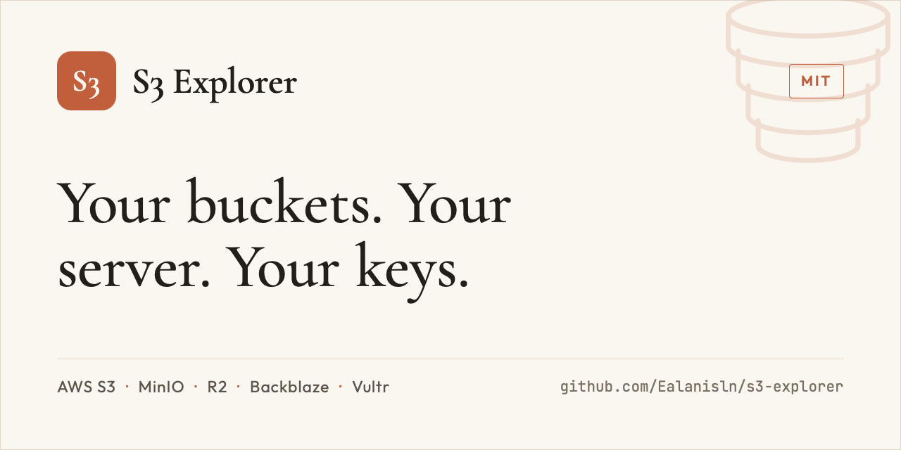
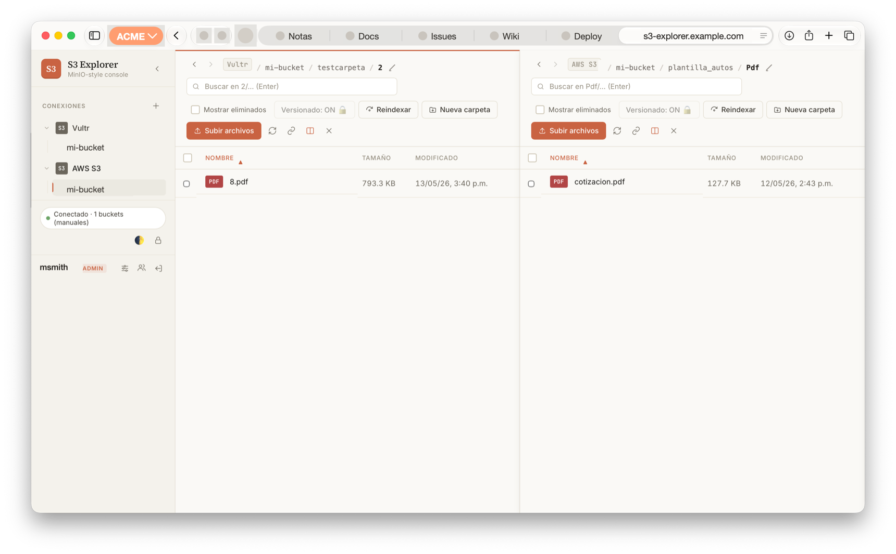
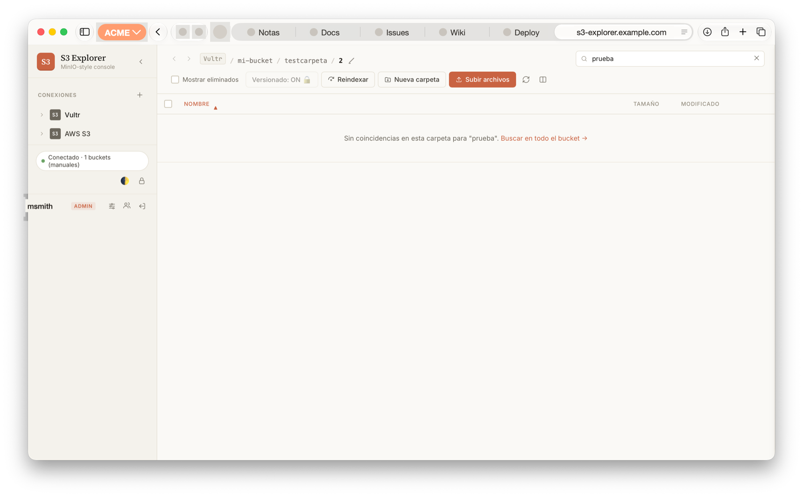
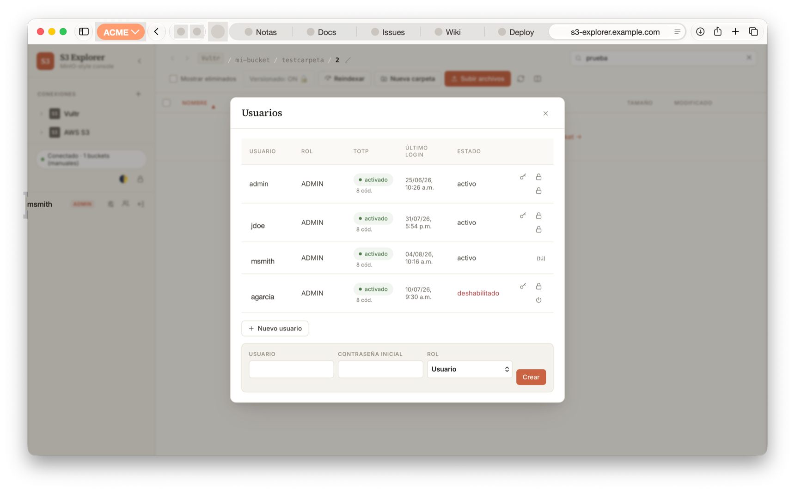

# S3 Explorer

**A MinIO-like web console for any S3-compatible storage.**

Self-hosted, multi-user file explorer for object storage. Each user brings their own S3 endpoints and credentials — the server never stores S3 keys. Built with Node.js + TypeScript + Express, a dependency-light vanilla TypeScript SPA, and SQLite. Ships as a two-container Docker Compose stack (app + Caddy with automatic TLS).

[](https://github.com/Ealanisln/s3-explorer/actions/workflows/ci.yml)
[](LICENSE)
[](https://github.com/Ealanisln/s3-explorer/releases)



## Features

**Explorer**

- **Multi-connection** — each user defines their own endpoints and credentials, and can connect to several providers at once.
- **Client-side encrypted vault** — S3 credentials are encrypted in the browser with AES-256-GCM (key derived via PBKDF2, 250k iterations, from a user passphrase) and stored in `localStorage`. Credentials reach the server only as transient per-request headers and are never persisted or logged.
- **Dual-pane explorer** — independent navigation per pane, per-pane back/forward history (Alt+←/→), "open in second pane", FileZilla-style synchronized navigation, and the ability to close either pane.
- **Transfers between connections** — recursive copy/move of folders across buckets and even across different providers, with concurrency and safety caps.
- **Uploads with conflict resolution** — replace / rename (auto-suffix) / skip when the file already exists.
- **Folder CRUD** — create, rename, delete (delete-marker or purge) and restore; deleted folders are flagged with a badge.
- **Streaming recursive search** — NDJSON streaming results grouped by folder, scoped to the current prefix, with folder-name matching and a per-user SQLite FTS5 index for fast key search.
- **Object versioning** — browse previous versions, restore, and show deleted objects. Suspending versioning is rejected server-side to prevent accidental data loss.
- **Inline previews** — images, video, audio, PDF, and code.
- **Presigned share links** — temporary signed URLs (5 min / 1 h / 24 h presets, configurable caps).

**Security**

- **TOTP two-factor authentication** — mandatory enrollment on first login (works with Google Authenticator, Authy, 1Password, etc.), with replay prevention: a used TOTP code cannot be reused within its validity window.
- **argon2id password hashing** (legacy bcrypt hashes are verified and transparently upgraded on login) and optional Have-I-Been-Pwned breach checks (k-anonymity) for new passwords.
- **128-bit single-use recovery codes**, bcrypt-hashed at rest.
- **Login rate limiting** — 5 attempts / 15 min per username + IP on the password and TOTP steps, and on the current-password check when changing a password.
- **SSRF / cloud-metadata protection** — user-supplied S3 endpoints are validated; IMDS and other cloud metadata endpoints (`169.254.0.0/16` in any IP encoding, GCP/Azure metadata hosts) are blocked by default, with optional endpoint deny/allow lists.
- **Hardened by default** — strict CSP with no inline scripts, host/origin allowlists (CSRF + DNS-rebinding defense), HMAC-signed httpOnly cookies, read-only container with `cap_drop: ALL`, and TOTP secrets encrypted at rest (AES-256-GCM).
- **Personal Access Tokens (API)** — scoped Bearer tokens (`read` / `write`) for agents and scripts, with optional expiry, per-user cap, one-time display (only the SHA-256 hash is stored), instant revocation, and per-IP rate limiting on failed attempts. Tokens never grant access to stored S3 credentials — none are stored server-side.
- **Admin user management UI** and a JSON-line audit log on stdout.

> **Note:** the UI is bilingual — Spanish and English, auto-detected from the browser language with a manual ES/EN toggle in the sidebar. Additional languages are a welcome contribution: add a dictionary file under `public/src/i18n/` mirroring `es.ts`.

## MCP server

S3 Explorer includes a [Model Context Protocol](https://modelcontextprotocol.io) server (`s3-explorer-mcp`) so AI agents like Claude Code and Claude Desktop can operate your buckets through the same authenticated API: list, browse, search, presigned links, uploads, and deletes — gated by a scoped Personal Access Token, with S3 credentials kept local and sent only as transient per-request headers. See [docs/mcp.md](docs/mcp.md) for setup and the tool reference.

## Works with

Any S3-compatible endpoint, including:

- AWS S3
- MinIO
- Vultr Object Storage
- Cloudflare R2
- Backblaze B2
- Wasabi, DigitalOcean Spaces, and others

## Screenshots

**Dual-pane explorer** — two connections side by side (here: Vultr Object Storage and AWS S3), with per-pane navigation, versioning status, and transfers between providers:



**Recursive search** — filter the current folder, or escalate to a full-bucket streaming search backed by the per-user FTS5 index:



**User management** — admin panel with per-user TOTP status, recovery codes, and disable/reset controls:



_UI shown in Spanish — an English UI is available via the ES/EN toggle in the topbar._

## Quick start

### Docker Compose (recommended)

Requires Docker with Compose v2, ports 80/443 open, and (for automatic Let's Encrypt) a public DNS name pointing at the host.

```bash
git clone <repo-url> s3-explorer
cd s3-explorer
cp .env.example .env

# Generate the required secrets and paste them into .env:
echo "ADMIN_PASS=$(openssl rand -base64 24 | tr -d '+/=' | head -c 20)"
echo "SESSION_SECRET=$(openssl rand -hex 32)"
echo "TOTP_ENCRYPTION_KEY=$(openssl rand -hex 32)"

# Set DOMAIN (and ADMIN_USER if you want) in .env, then:
docker compose up -d --build
docker compose logs -f s3-explorer
```

Open `https://<your-domain>`, log in with `ADMIN_USER` / `ADMIN_PASS`, enroll TOTP, and save your recovery codes.

TLS modes (see `Caddyfile`):

- **Public domain** — Caddy provisions and renews Let's Encrypt certificates automatically. No extra action.
- **Intranet** — uncomment `tls internal` in the `Caddyfile`; Caddy generates a local CA whose root certificate you distribute to users.

> **Do not rotate `TOTP_ENCRYPTION_KEY` after the first enrollment.** Rotating it makes every enrolled TOTP secret undecryptable; the admin would have to reset TOTP for all users. Keep it in your password manager.

### Backups

All server state lives in one SQLite file, `${DATA_DIR}/app.db` (`/data/app.db` in the `users_data` volume). It runs in WAL mode, so copying the file from a live container can miss the latest transactions; use SQLite's backup API instead:

```bash
docker compose exec s3-explorer node -e "require('better-sqlite3')(process.env.DATA_DIR + '/app.db').backup(process.env.DATA_DIR + '/app-backup.db')"
docker compose cp s3-explorer:/data/app-backup.db ./app-backup-$(date +%F).db
docker compose exec s3-explorer rm /data/app-backup.db
```

If a short downtime is fine, `docker compose stop s3-explorer` followed by `docker compose cp s3-explorer:/data/app.db ./app-backup-$(date +%F).db` is equivalent.

**Treat the backup as a secret**: it holds password hashes (argon2id), recovery-code hashes (bcrypt) and the TOTP seeds, encrypted with AES-256-GCM. Encrypt it at rest, and store `TOTP_ENCRYPTION_KEY` separately — without that key the TOTP seeds in the backup cannot be decrypted.

### Plain Node (no Docker)

Requires Node.js 22.5+ (24 recommended) and pnpm 11 (`corepack enable` picks the pinned version).

```bash
pnpm install
pnpm run build              # tsc -b → dist/ + public/dist/
SESSION_SECRET=$(openssl rand -hex 32) \
TOTP_ENCRYPTION_KEY=$(openssl rand -hex 32) \
ADMIN_USER=admin ADMIN_PASS=change-me \
DATA_DIR=./data \
pnpm start                  # listens on http://127.0.0.1:4569
```

Without a reverse proxy in front you should set `SECURE_COOKIE=0` for plain-HTTP local testing only — always run behind HTTPS in production.

## Configuration

All configuration is environment-driven (see `.env.example` for generation commands and extended notes).

| Variable | Default | Description |
|---|---|---|
| `DOMAIN` | — | Public or internal FQDN (required by the Compose stack; used for Caddy TLS and the host/origin allowlists) |
| `ADMIN_USER` | — | Initial admin username (honored only on first boot, while no users exist) |
| `ADMIN_PASS` | — | Initial admin password (change it from the UI after first login) |
| `SESSION_SECRET` | ephemeral random | HMAC-SHA256 key for signing session cookies. **Must be set in production** (the app refuses to start without it when `NODE_ENV=production`). Generate: `openssl rand -hex 32` |
| `TOTP_ENCRYPTION_KEY` | ephemeral random | AES-256-GCM key (64 hex chars) encrypting TOTP secrets at rest. **Must be set in production**; never rotate after enrollment. Generate: `openssl rand -hex 32` |
| `SESSION_TTL_SECONDS` | `43200` (12 h) | Absolute session lifetime from login. `.env.example` pins the recommended `14400` (4 h) |
| `MAX_UPLOAD_BYTES` | `2147483648` (2 GB) | Per-file upload limit. `.env.example` pins the recommended `524288000` (500 MB) |
| `CHECK_HIBP` | `1` | Check new passwords against Have I Been Pwned (k-anonymity; fails open if unreachable) |
| `ALLOWED_HOSTS` | `localhost:4569,...` | Accepted `Host` headers (DNS-rebinding defense). The Compose stack sets it from `${DOMAIN}` |
| `ALLOWED_ORIGINS` | `https://${DOMAIN}` (compose) | Accepted `Origin` values (CSRF defense) |
| `MAX_PRESIGN_SECONDS` | `86400` (24 h) | Upper cap for presigned-link TTL |
| `DEFAULT_PRESIGN_SECONDS` | `300` (5 min) | Presigned-link TTL when the client does not specify one |
| `DATA_DIR` | `/data` (Docker) | Where the SQLite DB (`app.db`) and per-user search index live. Must be a persistent volume |
| `DB_PATH` | `${DATA_DIR}/app.db` | Override the SQLite database path |
| `HOST` | `127.0.0.1` | Bind address (`0.0.0.0` inside Docker) |
| `PORT` | `4569` | HTTP port |
| `SECURE_COOKIE` | `1` | Set the `Secure` flag on cookies (requires HTTPS) |
| `TRUST_PROXY` | unset | Set to `1` behind a reverse proxy so rate limiting and audit logs see real client IPs |
| `TRANSFER_CONCURRENCY` | `4` | Parallel workers per recursive folder transfer (max 16) |
| `TRANSFER_MAX_PREFIX_ITEMS` | `100000` | Safety cap: refuse to transfer prefixes with more objects than this |
| `BLOCK_METADATA_ENDPOINTS` | `1` | Block cloud metadata endpoints (IMDS, GCP, Azure) as S3 endpoints |
| `S3_DENY_HOSTS` | empty | Extra comma-separated hostnames to deny as S3 endpoints |
| `S3_ALLOW_HOSTS` | empty | Opt-in allowlist: when set, **only** these hostnames are accepted as S3 endpoints (strongest SSRF posture) |

### Minimum IAM permissions (AWS)

Users without `s3:ListAllMyBuckets` can list their buckets explicitly in the connection form. The minimum per-bucket policy is:

```json
{
  "Version": "2012-10-17",
  "Statement": [{
    "Effect": "Allow",
    "Action": [
      "s3:ListBucket", "s3:ListBucketVersions",
      "s3:GetObject", "s3:GetObjectVersion",
      "s3:PutObject",
      "s3:DeleteObject", "s3:DeleteObjectVersion",
      "s3:GetBucketVersioning", "s3:PutBucketVersioning"
    ],
    "Resource": ["arn:aws:s3:::my-bucket", "arn:aws:s3:::my-bucket/*"]
  }]
}
```

## Development

```bash
pnpm install
pnpm run build          # tsc -b → dist/ (server) + public/dist/ (SPA)
pnpm run typecheck      # tsc -b --noEmit
pnpm test               # vitest run (unit + integration, mocked S3)
pnpm run test:unit
pnpm run test:integration
pnpm run test:coverage
pnpm run watch          # incremental rebuild
```

Layout: server code in `src/` (Express, better-sqlite3 with versioned migrations, AWS SDK v3), frontend in `public/src/` (framework-less TypeScript SPA, no bundler), tests in `tests/`. See `CLAUDE.md` for an architecture walkthrough and `SECURITY.md` for the security model, deployment hardening checklist, and vulnerability reporting.

CI runs `pnpm audit`, typecheck, the vitest suite, secret scanning (gitleaks) and CodeQL on every push and pull request. See [CONTRIBUTING.md](CONTRIBUTING.md) before opening a PR.

## Documentation

- [docs/api.md](docs/api.md) — HTTP API reference (auth flow, every `/auth/*` and `/api/*` endpoint, error shape).
- [docs/mcp.md](docs/mcp.md) — MCP server: setup for Claude Code / Claude Desktop, environment variables, and tool reference.
- [AGENTS.md](AGENTS.md) — contributor guide: dev setup, commands, architecture map, conventions, and security invariants.
- [docs/brand/](docs/brand/) — press kit: social cards, carousel, and banners, free to use when sharing the project.
- [SECURITY.md](SECURITY.md) — security policy, hardening checklist, and vulnerability reporting.

This repo also ships [`llms.txt`](llms.txt) and [`AGENTS.md`](AGENTS.md) so AI coding agents can orient themselves quickly — and an [MCP server](docs/mcp.md) so agents can operate your storage, not just the codebase.

## Authors

- [Emmanuel Alanis](https://github.com/Ealanisln) — creator and maintainer
- [Aziel Pichardo](https://github.com/AzielPD)
- [José Luis Bravo](https://github.com/jlvobra)

## License

[MIT](LICENSE) © 2026 Emmanuel Alanis
